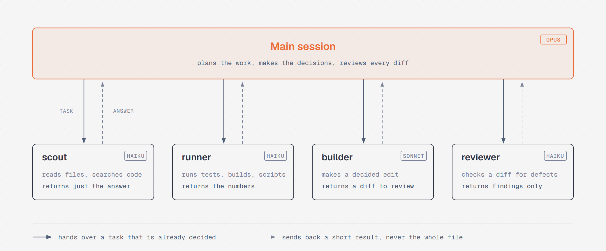
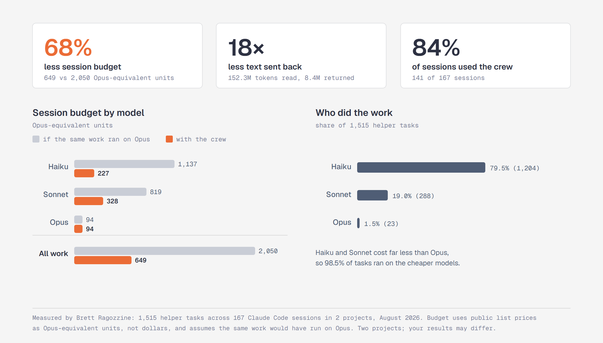

# architect-crew

A Claude Code plugin that makes long sessions cheaper. Your main session on Opus keeps the
thinking: planning, decisions and review. Reading, running and simple edits go to cheaper
helper models that send back only what matters.

## How it works

<p align="center">
  
</p>

| Helper | Model | Give it | You get back |
|---|---|---|---|
| scout | Haiku | a big file or a wide search | the answer and where it is, never the file |
| runner | Haiku | a command to run | the exact output and numbers |
| builder | Sonnet | an edit that's already decided | a diff for you to check |
| reviewer | Haiku | a diff, branch or file | the problems it found, no fixes |

Reading big files, running noisy commands and going through diffs line by line is what uses up
a session's budget. The helpers read a lot and hand back a little.

## Measured results

<p align="center">
  
</p>

From 1,515 helper tasks across 167 sessions in two projects. Budget is counted in
Opus-equivalent units from public list prices, not dollars.

## Install

In Claude Code:

```text
/plugin marketplace add Strong-Force-Analytics/claude-plugins
/plugin install architect-crew@sfa-plugins
/reload-plugins
```

Nothing else to set up. Use Opus as your main model (`/model opus`), then work as usual.

## Use it

The plugin adds a short set of rules at the start of every session that tell the main session
when to hand work off. You can also ask directly:

```text
Use scout to find where the retry logic is defined and who calls it.
Have runner run the test suite and report the failing tests.
Have builder rename getUser to fetchUser everywhere, then show me the diff.
Have reviewer check this branch for defects.
```

A few tips:

- **Hand over decisions, not problems.** "Rename X to Y in these files" works; "fix the login
  bug" stays with the main session.
- **Ask scout a specific question**, and say what you want back.
- **Check the diff, not the summary.** A helper can miss its own mistakes.

## Update or remove

```text
/plugin marketplace update
/plugin uninstall architect-crew@sfa-plugins
```

If the helpers don't show up, run `/reload-plugins` or start a new session. On Windows the
start-up rules need [Git for Windows](https://git-scm.com/download/win).

## Credits

The method, the scout, runner and builder helpers, the rules and the measurements are by
Brett Ragozzine. The reviewer was added by
[Strong Force Analytics](https://github.com/Strong-Force-Analytics). Changes are listed in
[CHANGELOG.md](CHANGELOG.md).

## License

[MIT](LICENSE)
